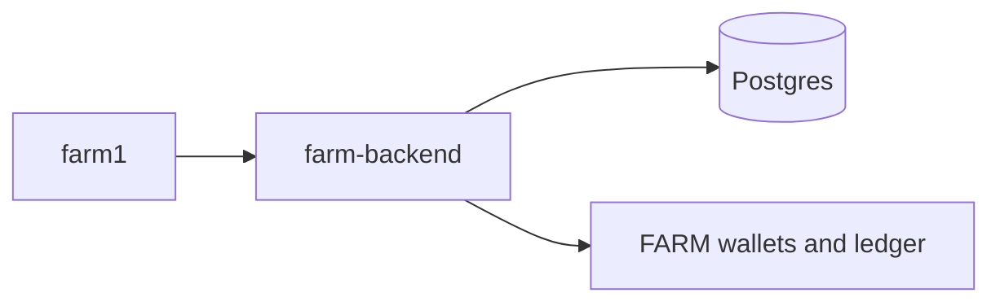
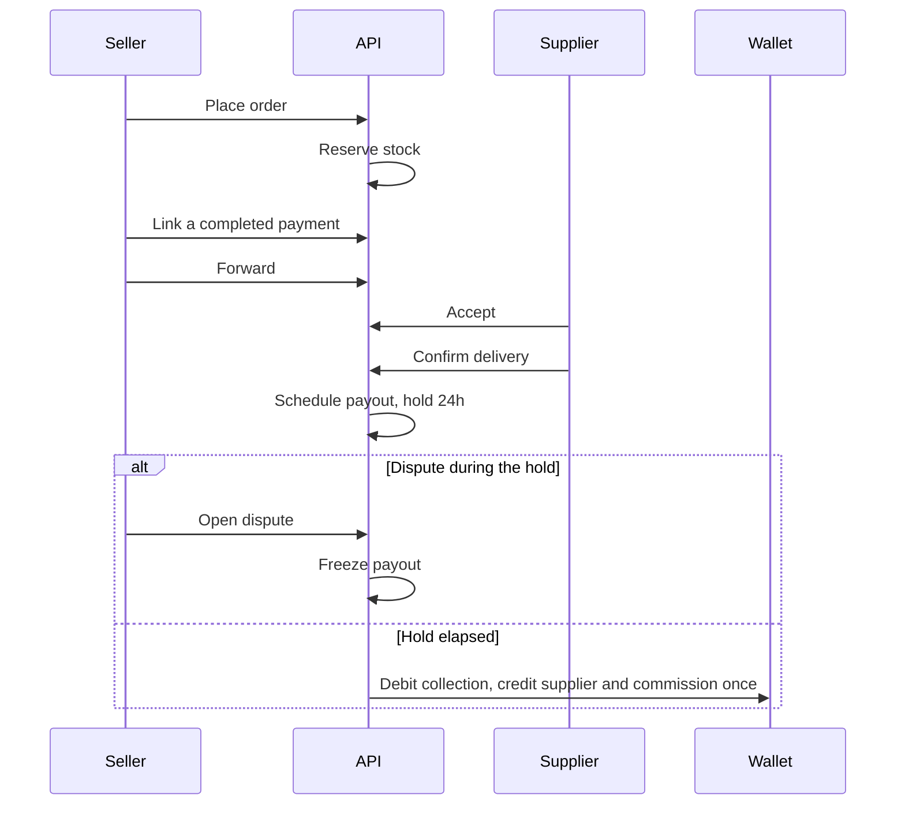
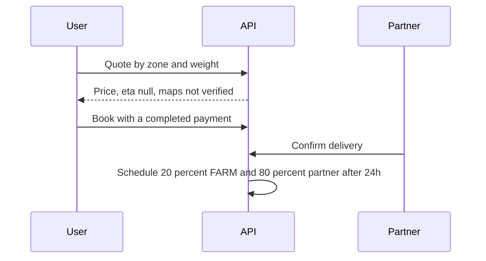

# Ecosystem architecture, data flow, and threat model

Reviewed with the routes on this branch. Tokenization is already approved and live. It is not a gap in this document. x402 is off.

## Architecture

Supplier and partner access are profiles on the existing user. They are not a fourth customer account type.

## Order and payout flow

## Cargo flow

## Threat model

| Area | What can go wrong | What this build does | Still open |
|---|---|---|---|
| Catalogue images | A non-https or script URL is stored and later rendered. | Only `https` URLs are accepted. File bytes are not stored on these routes. | The app must not treat the URL as safe HTML. Malware scanning is not added. |
| Stock | Two orders reserve the same unit. | Reserve uses a compare-and-set update. A lost race returns 409. | No database lock beyond that update. |
| Fake payment | The client says an order or shipment is paid. | Pay and book require a completed `transactions` row and a matching amount. | The original payment's own webhook is unchanged. |
| Payout double credit | Two workers release the same row. | Status moves from `scheduled` to `paying` inside the same database transaction as the wallet update. The kind and subject are unique. | A crash after commit is a paid row, not a second credit. |
| Payout without funds | The collection wallet cannot cover the debit. | The debit is conditional. The row stays scheduled and is retried. Balances do not go negative. | A missing `receiver_wallet_id` stays `blocked` until an admin can see it. Nothing is invented. |
| Dispute too late | The payout already left the hold. | A dispute freezes only `scheduled` rows. A paid row needs the admin reversal. | Reversal fails if the payee no longer has the balance. |
| Partner proof | The OTP is stored or logged. | Only a SHA-256 hash is stored. The code is returned once on create. | The response can still be logged by a client. |
| IDOR | One user reads another's shipment or product. | Lists and gets filter on the caller's user, merchant, or supplier id. | Admin routes rely on the admin role. |
| Notice leak | A push preview shows an amount or address. | These events are in-app only, and the body has no amount. | Email and SMS are not sent for them. |
| Commission | A silent 10% is applied to retail or shipping. | The base is wholesale. Shipping is a separate cargo charge. Unset bps stays null. | Production has set `DROPSHIP_COMMISSION_BPS=1000`. |
| x402 | An agent pays through an unverified protocol. | `X402_ENABLED` is false. The status flag stays unverified. | No new x402 work. |
| Chain | A payout is broadcast. | Payouts only update FARM wallet rows and ledger lines. | No on-chain send was added. |

Staging was not run for this branch. The unit tests cover the rules above. They are not a production exercise.
