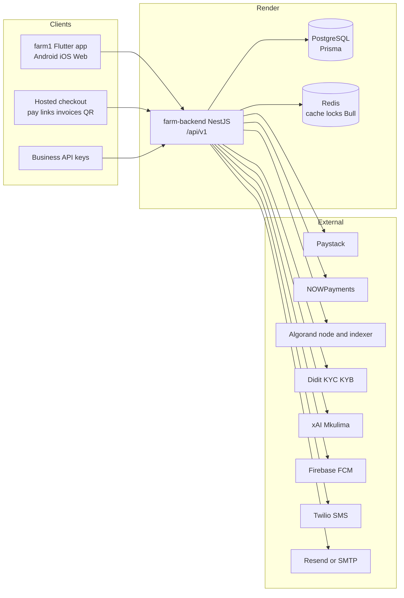
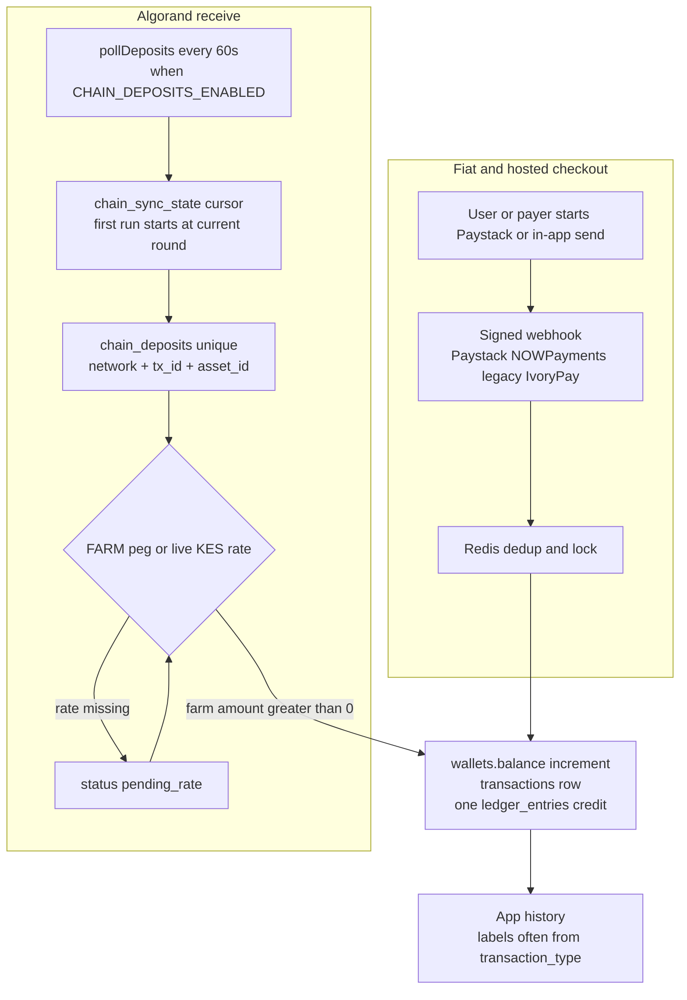

# Phase 0 — FARM ecosystem audit and design

**Status:** audit only. No feature code, no migrations, no deploys, no production access, no ledger credits.
**Date:** 2026-11-20
**Backend reviewed:** `tosh-8257/farm-backend` `main` @ `d3c55f3` (2026-11-13, “Add a SUPER_ADMIN HTTPS endpoint for custodial wallet backfill”).
**Frontend reviewed:** `tosh-8257/farm1` `main` @ `20d4d520` (2026-11-13, “Stop private notifications after logout and account switches”). Cloned read-only. Not a submodule of this repo.
**Method:** static reading of NestJS modules, Prisma schema, `render.yaml`, existing docs, and the Flutter app. Production Render environment values, the live database, and on-chain history were **not** queried. Nothing in this report is production-verified.

The master spec assumes a FlutterFlow-only frontend. That assumption is wrong for the source we can see. `farm1` is a Flutter application (`lib/`, `android/`, `ios/`, `web/`) that still uses FlutterFlow-generated patterns (`FlutterFlowTheme`, `FlutterFlowModel`, `lib/flutter_flow/`). Those screens are in Git and can be edited. A FlutterFlow cloud project, if one is still the design source of truth, was not accessible. New ecosystem screens (dropshipping, cargo, supplier, delivery partner) are absent from `farm1` as well.

This document is the Phase 0 deliverable. Implementation waits for owner approval.

---

## How to read the verdicts

| Label | Meaning |
|---|---|
| Implemented in source | Code and schema exist on `main`. |
| Source-verified | Behaviour follows from the code paths cited. Not executed against production. |
| Incomplete | A path exists but does not meet the spec or the owner report. |
| Missing | Searched; no application feature. |
| Not production-verified | Live env, database rows, and provider dashboards were not inspected. |

---

## Architecture (current)

What this diagram does **not** contain, because the code does not contain it: Shopify, WooCommerce, a product catalogue, dropshipping, suppliers, cargo, delivery partners, a dispatch engine, or a maps provider.

Account model in code, which must stay at three customer surfaces:

| Spec account | What the code actually uses |
|---|---|
| Personal | `users.role = user` plus a `wallets` row (`wallet_type = user`). `prisma/schema.prisma` `user_role`, `users`, `wallets`. |
| Merchant Portal | A `merchants` row (`pending` / `approved` / `rejected` / `suspended`). JWT role is **not** flipped to `merchant` on approval. `RolesGuard` grants merchant permissions from the merchants row. `src/merchants/`, `src/auth` roles guard. |
| Business Account | Separate `businesses` entity (`draft` → `under_review` → `approved` / `rejected` / `more_information_required`), Didit KYB, team roles. Not a `user_role` value. `src/business/`, `src/business-ops/`. |
| Supplier / delivery partner | Not a fourth customer type, and not implemented. Correct to keep them as operational roles later. |

`user_role` is only `user | merchant | admin | super_admin`. Admins are staff, not a customer type.

---

## Data flow (money that exists today)

Authoritative balance is `wallets.balance`, written on the server. `ledger_entries` is an audit trail. Internal P2P transfers write a debit and a credit (`src/wallets/wallets.service.ts`). Chain deposits, and several other credits, write a **single** credit line (`src/chain-wallet/chain-wallet.service.ts` `credit`). This is not a closed double-entry ledger. New cargo and dropshipping money must post through this wallet service, not a second balance.

---

## A. Already implemented and verified in source

These exist on `main` and match a working FARM wallet product. They were not re-executed in production during this audit.

### Platform

- NestJS 11 API, Prisma, PostgreSQL, versioned routes under `/api/v1`. Global prefix and versioning in `src/main.ts`. Health check `/health` in `render.yaml`.
- Render web service `farm-backend`, Postgres `farm-db`, Redis via `REDIS_URL` (`render.yaml`). Bull queues in use: `webhooks`, `expiry-tasks`, `payment-receipts`. `NOTIFICATIONS`, `ESCROW`, `PAYOUTS`, and `BLOCKCHAIN` queue names exist in constants and have **no** processor.
- Redis is used for cache, webhook replay locks, and those queues (`src/common/redis`, `src/webhook`).
- Auth: password login, Firebase phone verification on the login step that requires it, access JWT, refresh rotation, session revoke, device binding, biometric re-auth flag. `src/auth/`. Access TTL is `JWT_ACCESS_EXPIRES`, default **15 minutes** (`src/auth/auth.service.ts` `issueTokens`). Refresh default is **90 days** when long-lived mode is off and a duration is applied (`src/auth/session-policy.ts`). See Priority 5–6: `render.yaml` sets different, unused names.
- Tokens on device: `flutter_secure_storage` on Android and iOS. **Web** falls back to `SharedPreferences` (`farm1` `lib/services/secure_storage_service.dart`).
- KYC and KYB via Didit, with webhook event storage. `src/didit/`, `src/kyc/`, `docs/DIDIT_KYB.md`.
- Notifications: in-app rows, FCM push, email (Resend or SMTP), Twilio SMS. `src/notifications/`.
- Admin and super-admin HTTP API plus in-app admin screens in `farm1/lib/admin` and `lib/pages/superadmin`, `lib/pages/adminpage`. Audit log model `audit_logs`. Fee configuration table `fee_configurations`.
- Uploads to Cloudinary, JWT required. `src/uploads/uploads.controller.ts`.
- Support tickets. Personal escrow (`escrow_contracts`) and business escrow. Payment requests and transfer requests.
- Travel (flights and hotels) is implemented behind flags. It is **not** cargo. `src/travel/`.

### Personal wallet and payments

- Wallet read, internal send, transaction history. `GET/POST /api/v1/wallet`.
- Paystack deposits (card, bank, M-Pesa through Paystack) and Paystack withdrawals. `src/payments`, `src/paystack`, `src/withdraw`, `src/webhook`.
- NOWPayments crypto deposit and withdrawal, with webhook signature verification. `src/nowpayments`, `src/deposit`, `src/withdraw`.
- IvoryPay code and webhook routes remain. The middleware returns **410** when `IVORYPAY_RETIRED` is not `false`. `docs/IVORYPAY_RETIREMENT.md`. Treat IvoryPay as retired unless the owner explicitly re-enables it.
- Safaricom STK module exists (`src/stk`) and is imported, but no payment flow calls it. M-Pesa in the product goes through Paystack.
- QR merchant collection, hosted checkout, receipts. `src/qr`, `src/qr-payments`, `src/receipts`, `farm1` merchant and checkout pages.
- Merchant apply, dashboard, QR, transactions, manual payout request. `src/merchants/merchants.controller.ts`. Dashboard requires `approved` and KYC level ≥ 3 (`src/merchants/merchants.service.ts`).

### Business Account (keep; do not rebuild)

- Onboarding draft, submit, Didit KYB. `src/business/business.controller.ts`.
- Dashboard, business wallet, move-to-personal, customers, invoices and PDF, payment links, escrows and milestones, team invites and roles (`owner`, `admin`, `finance`, `accountant`, `operations`, `developer`). `src/business-ops/`.
- Developer API keys, webhooks, sandbox simulate-payment, public ` /api/v1/farm/* `. `src/business-api/`.
- Hosted payer pages ` /api/v1/pay/* ` and static `farm1/web/pay-doc.html`, `web/qr-checkout.html`.

### Investments, tokenization machinery, chain wallets

- Business project application: multi-step editor, milestones, documents, `POST /api/v1/business/projects/:id/submit` which **rejects** incomplete projects. Required documents: `business_plan`, `financial_statements`. Status machine in `src/project-marketplace/project-rules.ts`.
- Tokenization service: request, admin approve/reject, TestNet ASA mint, on-invest allocations, buybacks, distributions. **Off unless env is complete, and TestNet only.** `src/tokenization/algorand-config.ts`. Details in Priority 1.
- Custodial Algorand wallets, USDC opt-in for business, deposit watcher, FARM mirror/sync flags. `src/chain-wallet/`, `docs/CHAIN_DEPOSITS.md`, `docs/ONCHAIN_GO_LIVE.md`.
- Receive screen copy matches the backend asset set: ALGO, USDC (configured ASA id), FARM (configured ASA id), Algorand only. `farm1/lib/pages/chain_wallet/wallet_address_page.dart`.

### AI, agent payments, x402

- Mkulima chat and xAI speech-to-text. Payments are proposals; confirm endpoints require PIN. `src/ai-assistant/`, `docs/PHASE7_AI_ASSISTANT.md`, `docs/MKULIMA_VOICE.md`.
- Agent payment mandates and payment intents, with server caps. `src/agent-payments/`.
- x402 gateway, business resources, facilitator. Off unless `X402_ENABLED` and chain config. `src/x402/`, `docs/PHASE10_X402.md`. It does not provide escrow or chargebacks.
- NFC / tap-to-pay behind `NFC_PAY_ENABLED`. `src/nfc-pay/`.

### Brand in the Flutter repo

- Gold token `kBrandAccent = 0xFFD4AF37` in `farm1/lib/core/app_theme.dart`, wired through `FlutterFlowTheme.brandAccent`. It is already used on primary buttons, large balance figures, and some icons. Priority 13 asks for a **subtler** use (fine lines), not a new colour from zero.
- iOS display name is already `FARM` (`ios/Runner/Info.plist`). Android launcher label is still `FΛЯM_ΛP²` (Priority 3).
- Android `applicationId` is `farmapp.africa`. iOS bundle id in the Xcode project is `com.mycompany.farm`. Do not change either to fix the launcher label.

---

## B. Exists but incomplete or broken

| Area | What is wrong | Evidence |
|---|---|---|
| Session lifetime config | `render.yaml` sets `JWT_EXPIRATION=3600` and `JWT_REFRESH_EXPIRATION=604800`. Application code never reads those names. Access tokens use `JWT_ACCESS_EXPIRES`, default `15m`. | `render.yaml` lines 76–83; `src/auth/auth.service.ts` `issueTokens` / `JWT_ACCESS_EXPIRES`. |
| Login still steps through phone verification | `REQUIRE_PHONE_VERIFICATION` defaults on unless set to `false`. A fresh login can demand Firebase phone verification even when a refresh session should have avoided it. | `src/auth/auth.service.ts` around the phone-verification gate. |
| Web session storage | Web writes access and refresh tokens into `SharedPreferences` (browser storage), not a secure enclave. | `farm1/lib/services/secure_storage_service.dart` `kIsWeb` branch. |
| Invoice and payment-link identity | Hosted checkout creates `transactions.transaction_type = merchant_payment`. The app treats every `merchant_payment` as “Merchant QR” unless `source` is something else. Metadata `business_document` distinguishes invoice and payment link on the server, and the UI ignores it. | `src/qr-payments/qr-payments.service.ts` initialize path; `farm1/lib/utils/personal_activity.dart` `isMerchantQr`. |
| In-app invoice/link pays | Those use `transaction_type = transfer` plus `business_payments.source` of `invoice` or `payment_link`. History labels still do not have first-class types. | `src/business-ops` commerce send path; `transaction_type` enum in `prisma/schema.prisma` has no `payment_link` or `invoice` value. |
| Crypto limits | Endpoints exist, but the deposit screen demands a USD minimum and does not call `/wallet/deposit/crypto/minimum/:currency`. The list payload uses `minimum_deposit_usd`, which the parser does not read. `CRYPTO_COIN_LIMITS` is not in `render.yaml`. On-chain ALGO/USDC/FARM have **no** min/max API. | Priority 8. |
| Tokenization | Full TestNet pipeline exists and is disabled until four env vars are set. Mainnet is refused. The UI shows “Submit for tokenization” on a draft project detail page before documents and review are finished. There is no user-facing string “Tokenize-as-you-invest is not switched on yet” on current `main`; the card instead offers submit when the project looks “filled”, even if `on_invest_enabled` is false. | Priority 1 and 4. |
| Draft projects | Edit and delete documents. No delete/archive of the draft project itself. | Priority 2. |
| Business ID | `businesses.id` (UUID) is returned by `GET /api/v1/business/profile` and is **not shown** on the Business profile screen. “Allow a business” asks the user to paste that UUID and does not preview the business name before PIN. | Priority 9. |
| Mkulima daily cap | Users can edit caps, and the server rejects `daily_cap > 100_000` with “Daily cap cannot exceed 100,000 FARM”. Separate agent-mandate ceilings default to 50,000 per payment and 200,000 per month. | Priority 10. |
| Hey Mkulima | Wake-phrase **parsing** exists. Enabling the switch does not start the microphone. A second control, “Listen for Hey Mkulima”, opens a sheet. The long limitation paragraph sits on the composer. | Priority 11. |
| Chain deposit watcher | Works when flags and rates are set, idempotent per tx, and **does not backfill** history. No 5 USDC minimum in code. No admin view that lists unmatched hashes for support. No alert when `detected` rows sit uncredited. | Priority 12 and `docs/CHAIN_DEPOSITS.md`. |
| Ledger | Single-sided credits are normal. No supplier payable, partner earning, or cargo commission accounts. | `ledger_entries` model; `credit()` in chain wallet service. |
| Merchant role | Approval does not set `users.role`. Safe today because the guard checks the merchants table. Easy to get wrong if a new screen checks only the JWT role. | `src/admin` merchant decision vs `user_role`. |
| Bull queues | Four named queues have no worker. Do not assume background jobs exist for payouts or chain work. Chain deposits use `@Interval`, not Bull. | `src/common/constants`. |
| IvoryPay | Routes still documented in `README.md` as live. Runtime default is retired. README and code disagree. | `README.md` IvoryPay section vs `docs/IVORYPAY_RETIREMENT.md`. |
| QR HMAC fallback | One admin path falls back to a hardcoded string when `QR_HMAC_SECRET` is unset. Production validation requires the env var, so this matters if that check is ever bypassed. | `src/admin/admin.service.ts` QR signing. Do not copy the fallback into new code. |
| Maps | No geocoding, no Mapbox, no Google Maps client in application code. | Search of `src/` and `farm1/lib`. |
| Tests | Many unit specs exist (chain deposits, tokenization, auth refresh, NOWPayments minimums). This audit did not run them. Do not treat them as a staging pass. | `src/**/*.spec.ts`. |

---

## C. Missing

Searched `src/` and `farm1/lib` for dropship, supplier portal, cargo, shipment, delivery partner, dispatch, Shopify, WooCommerce, product catalogue, mini-store, parcel, freight, and maps. No application feature. Travel “supplier timeout” and npm package names are unrelated.

Entirely absent relative to the master spec:

- Shared dropshipping engine, Lite and Pro.
- Supplier profiles, catalogue, stock, wholesale price, order accept/reject.
- Mini-store / seller listings / markup / profit breakdown.
- Shopify and WooCommerce connections, bulk import, order sync.
- FARM Cargo: quotes, shipments, zones, proof of delivery, returns.
- Delivery partner onboarding (rider, vehicle, logistics company) and partner portal.
- Dispatch queue, assignment locking, GPS pings, navigation handoff.
- Cargo admin (zones, pricing rules, manual assign).
- Configurable dropshipping commission (proposed 10%) as its own rule. Existing `fee_configurations` cover current FARM fees only. Do not reuse those rows silently.
- Ledger buckets: supplier payable, seller net, cargo charge, partner earning, dropshipping commission.
- Public Business ID or business search.
- Per-coin on-chain deposit and withdrawal limits.
- First-class transaction types for payment link and invoice.
- User deletion of draft projects.
- Hands-free wake capture without a second tap.
- Reconciliation console for a chain deposit that was never inserted.

Also absent, and should stay absent until a real partner exists: advertised routes, live tracking, fake suppliers, and fake ratings.

---

## D. Frontend that is inaccessible

| Item | Where it actually lives |
|---|---|
| Personal, merchant, business, wallet, QR, invoices, projects, Mkulima, travel, x402, admin | **In git**, `farm1` `main` @ `20d4d520`. Editable Dart. FlutterFlow-style generated widgets are checked in. |
| FlutterFlow cloud project | **Not accessible** from this run. If design edits still happen only in FlutterFlow and are not exported, those edits are invisible here. Owner must say whether GitHub `farm1` is canonical. |
| Dropshipping, supplier, cargo, partner, dispatch screens | **Nowhere we can read.** They are not in `farm1`. They are not in this backend. Do not assume a FlutterFlow page exists for them. |
| Android `_AP2` label | In git: `farm1/android/app/src/main/res/values/strings.xml` (`FΛЯM_ΛP²`). iOS already says `FARM`. Web title is `FARM` (`web/index.html`). |
| `farm1` branches that are not `main` | The remote has branches such as `feat/gold-accent`, `feat/tokenize-project-ui`, `fix/crypto-withdraw-range`, and `cursor/session-team-voice-fixes`. This audit did **not** review them. `main` is the baseline. |

No FlutterFlow export is required to fix Modules 15–18, except where a screen exists only in an unexported FlutterFlow project. None of the cited bug screens were missing from `farm1`.

---

## E. Required database and API changes

Do not apply these until a later approved phase. Names below are proposals. Reuse the tables in the “maps to” column instead of duplicating users, wallets, or businesses.

### E1. Bug-fix schema (do this before ecosystem tables)

| Change | Why | Notes |
|---|---|---|
| No new balance column | Payment-type fix | Add `transactions.channel` (or a dedicated enum value) set at initiation: `qr`, `payment_link`, `invoice`, `p2p`, `chain_deposit`, `nowpayments`, `paystack`. Keep `metadata.business_document` as a legacy hint. Backfill only rows whose metadata or `business_payments.source` proves the channel. |
| Optional `transaction_type` values `payment_link` and `invoice_payment` | History and exports | Prefer a new `channel` column if changing the Postgres enum is riskier. Either way, stop inferring QR from `merchant_payment` alone. |
| `businesses.public_code` unique, generated, immutable | Priority 9 | Keep `id` UUID as the internal key. Show `public_code` in profile. Lookup by exact code. Do not create a second business row. |
| `chain_deposits` support fields already exist (`tx_id`, `network`, `asset_id`, `status`, `error`, `farm_amount`) | Priority 12 | Add an admin list/filter API before adding columns. A `resolution_note` and `alerted_at` can wait for the reconciliation UI. |
| `ai_spend_permissions` | Priority 10 | No schema change required to remove the hard 100,000 check. If a real ceiling is approved, store it in `system_settings` or env, not a magic number. |
| Project draft delete | Priority 2 | Soft-delete columns on `investment_projects` (`deleted_at`, `deleted_by`) **or** status `discarded` allowed only from `draft`. Do not hard-delete projects that have documents in storage, investments, tokens, or escrow. |

`transaction_type` today (`prisma/schema.prisma`): `deposit`, `withdrawal`, `transfer`, `transfer_request`, `merchant_payment`, `escrow_lock`, `escrow_release`, `escrow_refund`, `investment`, `roi_payout`, `fee`, `investment_refund`, `token_buyback`, `token_distribution`, `project_return`, `investment_settlement`, `conversion`, `cross_border`, `mkulima_usage`.

### E2. Ecosystem schema (after bug fixes, incremental)

Map first:

| Spec entity | Already have | Add only if the phase needs it |
|---|---|---|
| Users, sessions, KYC | `users`, `user_sessions`, `kyc_documents` | — |
| Merchant | `merchants` | — |
| Business, team, API keys | `businesses`, `business_members`, `api_keys` | — |
| Wallet and ledger | `wallets`, `transactions`, `ledger_entries` | Posting rules, not a second wallet |
| Fees | `fee_configurations` | New `commission_rules` so dropshipping and cargo fees cannot overwrite merchant/escrow/withdrawal fees |
| Notifications, audit, webhooks | `notifications`, `audit_logs`, `webhook_logs` | — |
| Orders / products / inventory / shipments / partners | none | Tables below |

Proposed tables (status enums as Postgres enums or checked strings, matching existing style):

- `supplier_profiles` — `user_id` nullable, `business_id` nullable, exactly one owner, `kind` individual or business, `status` draft / submitted / under_review / more_information_required / approved / rejected / suspended, regions, terms.
- `supplier_documents` — private file key, kind, expiry, reviewer, not a public URL.
- `supplier_products` and `product_variants` — SKU unique per supplier, wholesale price, MOQ, currency `FARM`.
- `supplier_inventory` — on-hand, reserved. Reservation updates inside the order transaction.
- `store_listings` — seller is `merchant_id` or `business_id`, variant id, retail price, published flag. This is the mini-store. One table for Lite and Pro.
- `external_store_connections` — business only, platform `shopify` or `woocommerce`, sealed credentials, shop domain, status.
- `external_store_sync_jobs` — idempotency key, cursor, last error.
- `sales_orders` and `sales_order_items` — channel `mini_store` / `shopify` / `woocommerce`, buyer, seller, payment status, idempotency key unique.
- `supplier_fulfilments` — one per supplier on an order, accept/reject, timeouts.
- `cargo_service_zones`, `cargo_pricing_rules` — admin-configured, not hardcoded.
- `cargo_quotes` — snapshot of the price the customer accepted.
- `cargo_shipments` and `cargo_shipment_events` — state machine, link to `sales_orders` nullable so personal parcels work.
- `delivery_partner_profiles`, `delivery_partner_documents`, `partner_vehicles`, `partner_drivers` — company fleet is drivers on a company profile, not a new user role.
- `delivery_jobs`, `delivery_assignments` — partial unique index: one active assignment per job.
- `location_updates` — job id required, retained for a short window, no pings when offline.
- `proof_of_delivery` — otp hash, signature or photo key.
- `partner_earnings`, `supplier_payables`, `payout_records` — point at `transactions.id`. Idempotent payout key.
- `commerce_disputes`, `commerce_returns`.
- `integration_accounts` — only if Shopify/Woo credentials should not live on the connection row.

Indexes: foreign keys to `users` / `businesses` / `merchants` / `wallets`, unique idempotency keys, status + updated_at for queues. Financial and assignment changes run in one Postgres transaction. Redis may lock a job offer; Postgres remains the source of truth.

### E3. API plan (later phases)

All routes under `/api/v1`, JWT or business API key, ownership checks, pagination, idempotency on money and order writes.

**Phase repair (existing app)**

- `DELETE /business/projects/:id` — draft only, owner or `projects:manage`, soft delete.
- `GET /business/profile` — include `public_code` (and keep `id`).
- `GET /agent-payments/businesses/lookup?code=` — returns trading name and status only, before mandate create.
- `PATCH /ai/permissions` — remove the unexplained 100,000 ceiling; enforce the approved ceiling and show it in the error.
- `GET /wallet/deposit/crypto/limits/:currency` and withdraw twin — stable shape: `min_amount`, `max_amount` nullable, `min_usd`, `max_usd` nullable, `network`, `fee_estimate`, `source`, `fetched_at`. Same shape for on-chain assets `algo`, `usdc-algorand`, `farm-algorand` even when max is null.
- Transaction list — return `channel` so the app can label Payment link, Invoice, and QR without guessing.
- `GET /admin/chain/deposits` — filter by tx id, address, status, asset. Read-only. The existing `POST /admin/chain/deposits/credit` stays super-admin, dry-run first, and is not part of this audit.

**Dropshipping and supplier**

- Supplier: `POST /suppliers/apply`, document upload, product CRUD, incoming orders, accept/reject.
- Seller: `GET /catalog`, `POST /listings`, order list, forward/cancel.
- Admin: supplier decision, suspend product.
- Webhooks in: Shopify and WooCommerce, signature required, stored in `webhook_logs` before side effects.

**Cargo and dispatch**

- `POST /cargo/quotes`, `POST /cargo/shipments` with idempotency key.
- Partner: availability, job offer accept/reject, status, proof.
- Admin: assign, reassign, pricing, zones.
- Location: `POST /cargo/jobs/:id/location` only while the assignment is active.

**Money**

- One internal posting function with entry types: collection, supplier payable, seller net, farm commission, delivery charge, partner earning, refund, adjustment. Each call idempotent on `(source, external_id, entry_type)`.

---

## F. Integrations that need credentials, approval, or docs

Values were not read. Names only.

| Integration | In code | To go further |
|---|---|---|
| Paystack | Wired for deposits, withdrawals, webhooks | Confirm live keys and webhook secret are set on Render. Do not send keys in chat. |
| NOWPayments | Wired for crypto pay-in and payout | API key, email, password, IPN secret, payout IPN URL, 2FA secret. Confirm which tickers are enabled (especially USDC networks). `CRYPTO_COIN_LIMITS` is optional JSON and is unset in `render.yaml`. |
| IvoryPay | Retired by default | Leave retired unless the owner orders a return. README is stale. |
| Safaricom STK | Module only | Daraja shortcode, passkey, consumer key/secret, callback URL, and a product decision. Not required for current M-Pesa. |
| Didit | KYC, KYB, device recovery | API key, webhook secret, workflow ids. |
| Cloudinary | Uploads | Cloud name, API key, secret. |
| Firebase | Phone auth, FCM, password reset | Client files live in `farm1`. Server needs project id, client email, private key. |
| Twilio and Resend/SMTP | SMS and email | Account SID, auth token, from-number; Resend key or SMTP. |
| Algorand | Custodial wallets, deposits, tokenization, x402 | Node URL, indexer URL, token, funder mnemonic, issuer mnemonic, reserve address and mnemonic, `USDC_ASA_ID`, `FARM_ASA_ID`, `WALLET_KEY_ENCRYPTION_KEY`, rate URLs. Tokenization additionally needs `TOKENIZATION_ENABLED=true` and `ALGORAND_NETWORK=testnet`. Mainnet needs `ALGORAND_ALLOW_MAINNET` and a separate legal approval. **Do not paste mnemonics.** |
| xAI | Mkulima | `AI_API_KEY`, model. Already referenced in `render.yaml` as dashboard secrets. |
| x402 | Implemented, flagged off | Protocol review against current x402 and Algorand docs before calling it production. No extra vendor account beyond Algorand. |
| Shopify | Missing | Partner app, scopes, webhook secret, shop domain. Official API only. |
| WooCommerce | Missing | REST keys, webhook secret, store URL. Official API only. |
| Google Maps or Mapbox | Missing | Owner picks one after coverage and pricing. Keys stay server-side for geocoding. |
| Duffel / PKFare / LiteAPI | Travel only | Not part of cargo. |
| Cloudflare | Owner says DNS/CDN for Farmapp.Africa | This repo’s `render.yaml` CORS value is a `workers.dev` wildcard. Confirm the real customer domain and CORS list out of band. |
| App stores | Android applicationId `farmapp.africa` | Launcher rename must not create a new listing. |

---

## G. Phased build sequence, risks, acceptance tests

The spec’s Phases 1–7 stay valid **after** the live-app repairs. Do not start dropshipping on top of mis-labelled payments and an unreconciled deposit watcher.

### Recommended sequence

1. **Repair A — money incidents and payment identity** (own branch, staging first): channel on transactions; history labels; deposit watcher diagnostics and alert; do not credit the 5 USDC until a tx id is verified. Acceptance: duplicate webhook does not double-credit; invoice checkout is not labelled QR; a fixture chain tx credits once.
2. **Repair B — session**: set `JWT_ACCESS_EXPIRES` / `JWT_REFRESH_EXPIRES` to the intended lifetimes; stop treating a failed upload as logout; one refresh lock (already partly in `RefreshManager`). Acceptance: expired access token refreshes once under parallel calls; upload and Mkulima payment return do not clear the session; explicit logout does.
3. **Repair C — Business ID and AI caps**: show and copy public code; lookup name before PIN; replace the unexplained 100,000 cap with the owner’s written ceiling; keep PIN. Acceptance: bad id, own business, unapproved business, over-cap, and PIN failure all refuse.
4. **Repair D — crypto limits**: one response shape; deposit screen accepts coin-unit bounds; surface on-chain asset policy honestly (no invented max). Acceptance: two coins show different mins; provider timeout shows an error, not zero.
5. **Repair E — projects**: draft delete; move tokenization submit to the end of a complete application; keep the TestNet-disabled state truthful. Do not enable mainnet. Acceptance: other users’ drafts, submitted projects, and incomplete documents cannot be deleted or tokenized.
6. **Repair F — voice and brand**: foreground wake without a second tap where the OS allows; compact listening indicator; Android label change only; gold limited to hairlines. Acceptance: payment speech still requires PIN; package id unchanged.
7. **Phase 1 foundation** (spec): permissions for future supplier and partner roles, audit events, idempotency helper, job runner that actually has a processor, staging.
8. **Phase 2** Merchant polish + shared catalogue + Dropshipping Lite + supplier admin. No Shopify yet.
9. **Phase 3** Dropshipping Pro on the existing Business Account. Shopify/Woo only after API review.
10. **Phase 4** Cargo quotes and shipments for zones FARM can actually serve.
11. **Phase 5** Partner onboarding and FARM dispatch. No Shipday dependency.
12. **Phase 6** Settlement reports, AI assistant for catalogue text with no wallet authority, x402 only after a fresh protocol review.
13. **Phase 7** Staging acceptance, security review, owner approval before any production migrate or deploy.

### Risks

- Custodial mnemonics and a missed deposit are the highest-impact items. A watcher that starts at “now” will ignore earlier transfers forever unless an admin replays a specific tx.
- Changing `transaction_type` in place can mis-state old rows. Backfill only when metadata proves the channel.
- Enabling tokenization or mainnet without legal review is out of scope and dangerous.
- A second wallet balance for cargo would split the ledger. Forbidden.
- FlutterFlow and GitHub diverging would make app fixes land in the wrong tree.
- `JWT_*` name mismatch may already be why production access tokens last 15 minutes while the blueprint says 3600 seconds. Confirm on Render before changing production.
- Kenya transport, insurance, tax, and data-protection rules are not established in code. Do not claim compliance.

### Acceptance tests (for later phases; none of these were run here)

Use the spec’s Module 13 list. Minimum bar before calling a repair done:

- Unit tests on channel labelling, draft-delete guards, cap checks, and deposit idempotency.
- API tests with sandbox Paystack/NOWPayments where credentials exist.
- One staging device: login, background the app past access-token expiry, upload a project image, pay a test invoice, and confirm the session and the label.
- Chain: TestNet payment to a custodial address, observed in `chain_deposits` and credited once. A second delivery of the same tx id does not credit again.
- Do not use customer funds. Do not call `POST /api/v1/admin/chain/deposits/credit` against production in the name of testing.

---

## Modules 15–18 triage

Severity: **P0** financial loss or wrong money, **P1** auth or payment integrity, **P2** blocked core task, **P3** polish.
“Reproduced” means re-run by this audit. These items were **not** reproduced on a device or against production. Causes below are from source.

| ID | Owner report | Verification | Suspected cause | Severity | Affected code | Proposed fix | External info | Ready? |
|---|---|---|---|---|---|---|---|---|
| 5–6 | Logout on upload, Mkulima pay, and after idle; SMS again | Not reproduced. Source-verified paths. | Access JWT defaults to 15m because `JWT_EXPIRATION` in `render.yaml` is unread. Upload and API clients do retry refresh once on 401 (`farm1` `lib/backend/services/api_service.dart`, `lib/services/auth/refresh_manager.dart`). Refresh 401/403 with a terminal message calls `SessionEnd.forceLocalSignOut`. Web stores tokens in `SharedPreferences`. Phone verification is a login step (`REQUIRE_PHONE_VERIFICATION`), not every API call. | P1 | `render.yaml`; `src/auth/auth.service.ts`; `src/auth/session-policy.ts`; `farm1` `lib/services/auth/refresh_manager.dart`, `lib/services/secure_storage_service.dart`, `lib/backend/services/api_service.dart` | Set the env names the code reads. Confirm one in-flight refresh. Do not logout on 403 or on a failed upload after a successful refresh. Document when SMS is required: new login, revoked refresh, new device, step-up. | Owner: desired access and refresh lifetimes; whether SMS on every cold start is still happening after a normal kill/reopen; platform (Android, iOS, or web). | Staging only, after env confirmation. Not production. |
| 7 | Payment links and invoices show as QR merchant payments | Source-verified. Not checked on live data. | Checkout inserts `merchant_payment` (`src/qr-payments/qr-payments.service.ts` around the `transactions.create` in `initialize`). `isMerchantQr` returns true for every `merchant_payment` (`farm1/lib/utils/personal_activity.dart`). Server metadata `business_document` is `invoice` or `payment_link` and is not what the list title uses. | P1 | `src/qr-payments/qr-payments.service.ts`; `src/business-ops` pay-document flow; `prisma/schema.prisma` `transaction_type`; `farm1/lib/utils/personal_activity.dart`; `lib/pages/all_transactions/all_transactions_widget.dart`; `lib/pages/dashboard/dashboard_widget.dart` | Persist channel at creation. Label from channel. Do not relabel on webhook. Backfill only rows with `business_document` or `business_payments.source`. | A sample live transaction reference for one invoice payment and one QR payment, if the owner wants the backfill checked. | Staging. Historical backfill needs owner approval. |
| 12 | 5 USDC received on Algorand not credited; ~7.531602 USDC earlier was | **Not resolvable.** No tx id was in the spec or the repo. Code path is documented below. There is **no** 5 USDC minimum in the crediting function. | See Priority 12. Most plausible code gaps: cursor starts at current round with no backfill; USDC held in `pending_rate` when the KES rate is missing; business address ignored until USDC opt-in; wrong network or wrong ASA never inserted. | P0 investigation | `src/chain-wallet/chain-wallet.service.ts`; `src/chain-wallet/chain-config.ts`; `docs/CHAIN_DEPOSITS.md`; `farm1/lib/pages/chain_wallet/wallet_address_page.dart` | Diagnostics and alert. Credit only after indexer proof, once, through the existing idempotent path. | Tx hash, sender, time, network, asset id, destination address, and the credited ~7.53 tx hash. | Blocked on the hash. No credit in this phase. |
| 9 | Cannot find a Business ID on “Allow a business” | Source-verified. | Profile API selects `id` (`src/business-ops/business-team.service.ts` `getProfile`) but the profile UI never prints it (`farm1/lib/pages/business/ops/team_pages.dart`). Allow-a-business validates a UUID locally and only then calls create (`agent_payments_pages.dart`). Server `createMandate` checks the business exists and is approved **after** PIN (`src/agent-payments/agent-payments.service.ts`). No public code, no search, no name preview. | P1 | Schema `businesses`; `business-team.service.ts`; `farm1` team profile and `lib/pages/agent_payments/agent_payments_pages.dart`; `agent-payments.service.ts` `createMandate` | Stable public code, shown with copy. Lookup endpoint returns name and status before PIN. Reject unknown, unapproved, own-business. | Owner: preferred code shape (short human code vs showing the UUID). | Staging. |
| 10 | Remove hard 100,000 FARM AI cap | Source-verified. | `updatePermissions` throws if `daily_cap > 100_000` (`src/ai-assistant/ai-assistant.service.ts`). The app lets the user type any number and surfaces the server error (`assistant_pages.dart`). Agent mandates have separate env caps `AGENT_MAX_PER_TX_FARM` (default 50,000) and `AGENT_MAX_MONTHLY_FARM` (default 200,000). Invoice/link DTOs also use `@Max(100000)` and P2P has `MAX_SINGLE_TX = 100_000`. Those are not the AI screen; do not change them in the same patch without a decision. | P1 | `src/ai-assistant/ai-assistant.service.ts`; `farm1/lib/pages/assistant/assistant_pages.dart`; `src/agent-payments/agent-payments.service.ts` `limits()` | Delete the unexplained 100,000 check. Enforce a named ceiling from settings, shown in the UI. Keep per-tx ≤ daily, server checks before execution, and PIN. AI must not send money. | Owner: the real per-payment, daily, and monthly ceilings, or written confirmation that only agent-mandate env caps apply. | Staging. Not production until the ceiling is written down. |
| 8 | Crypto deposit and withdrawal limits do not load per coin | Source-verified mismatch. Not called live. | Deposit UI `fetchDepositCoinLimit` hits `/wallet/deposit/crypto/limits/:currency` then the list route, and then **requires `minUsd`** (`depositpage_widget.dart`). It never calls `/wallet/deposit/crypto/minimum/:currency`. List payload field is `minimum_deposit_usd` (`deposit.service.ts` `getCryptoLimits`). Per-currency deposit limits delegate to NOWPayments min-amount. Withdraw `GET /withdraw/crypto/limits/:currency` returns `resolveCoinBounds` (`min_amount` / `max_amount`) only if the ticker is in NOWPayments’ list (`withdraw.service.ts` `getCryptoCoinLimit`). `CRYPTO_COIN_LIMITS` unset means max is null. On-chain receive screen has no limits. | P1 | `src/crypto/coin-limits.ts`; `src/deposit/deposit.service.ts`; `src/withdraw/withdraw.service.ts`; `farm1/lib/core/crypto_coin_limit.dart`; `lib/pages/depositpage/depositpage_widget.dart`; `lib/pages/withdrawpage/withdrawpage_widget.dart` | One DTO. Map `minimumUsd` and `minimum_deposit_usd`. Show “no maximum published”. Add an on-chain limits response that does not pretend NOWPayments is the chain. Fail the withdrawal if limits did not load. | Which coins and networks are in the product (NOWPayments tickers vs Algorand ASA). Whether a FARM product minimum (the reported 5 USDC) should exist. It does not exist in code today. | Staging with sandbox NOWPayments. |
| 2 | Cannot clear own draft projects | Source-verified absence. | Business project routes have no `DELETE` of the project. Document delete exists. Status list has no user discard. `src/project-marketplace/project-marketplace.controller.ts`, `project-rules.ts` `EDITABLE`. | P2 | Those files; `farm1/lib/pages/business/ops/project_pages.dart` | Soft-delete or `discarded` from `draft` only, confirmation, owner check, audit row. | None. | Staging. |
| 1 | Project tokenization does not work | Source-verified gates. Not executed on TestNet. | `algorandConfig().enabled` is false unless `TOKENIZATION_ENABLED`, `ALGORAND_NETWORK=testnet`, `ALGORAND_NODE_URL` (https), and `ALGORAND_ISSUER_MNEMONIC` are all set. Mainnet is an error. `render.yaml` does not set these. Admin mint returns 503 when disabled (`tokenization.service.ts` `approveAndMint`). On-invest also needs `TOKENIZE_ON_INVEST_ENABLED=true` plus chain wallets on the same network (`on-invest.ts`). UI can still show the submit button. | P2 product, P0 if enabled without legal review | `src/tokenization/algorand-config.ts`, `on-invest.ts`, `tokenization.service.ts`, `tokenization.controller.ts`; `farm1/lib/pages/business/ops/project_pages.dart` `TokenizationCard` | Keep it off in production until the owner approves network, legal, and ops. Make the card say that it is not available, and why, using `GET /tokenization/status`. Do not hide the gate by deleting the message. | Owner: TestNet demo vs Mainnet product; issuer key custody; whether “tokenize as you invest” is the intended product. | Not production. |
| 4 | “Submit for tokenization” appears before the application is complete | Source-verified. | `TokenizationCard` is on the project detail page for every non-rejected status, including `draft`, directly under “Submit for review” (`project_pages.dart`). `projectCanSubmitForTokenization` allows empty, draft, and more-info. Server `POST .../tokenization` does not check required documents. `POST .../submit` does. | P2 | `farm1/lib/pages/business/ops/project_logic.dart`, `project_pages.dart`; `src/tokenization/tokenization.service.ts` request method; `src/project-marketplace/business-projects.service.ts` `submit` | Wizard ends with review, then “Submit for review”. Tokenization action only after approval and the feature flag. Separate the two buttons in copy. | Copy approval for the disabled state. | App change can be staging-tested without enabling chain. |
| 11 | Hands-free Hey Mkulima still needs a mic tap and covers the UI | Source-verified. | `parseHandsFree` works (`hands_free.dart`). `_setHandsFree` only saves a preference. The listen control calls `_voice(..., requireWake: true)` (`assistant_pages.dart`). Subtitle is the full `handsFreeLimits` paragraph. Headset media keys can start capture. No background listener, which is correct. | P3 | `farm1/lib/pages/assistant/hands_free.dart`, `assistant_pages.dart`, `voice_input.dart` | When the switch is on and the app is foreground, start capture without the extra button if permission is granted. Move the paragraph to help. Keep PIN on payments. | None for a foreground-only design. Do not promise lock-screen listening. | Staging on Android and iOS. |
| 3 | Remove `_AP2` from the launcher name | Source-verified. | `android/.../res/values/strings.xml` `app_name` is `FΛЯM_ΛP²`. `AndroidManifest` uses `@string/app_name`. iOS `CFBundleDisplayName` is already `FARM`. `applicationId` is `farmapp.africa`. | P3 | That strings file only, plus any other user-visible “AP2” (none found in Dart). | Change the string resource to the approved display name. Do not change applicationId, bundle id, or signing. | Exact launcher string: `FARM` or `FΛЯM`. | Needs a test build, not a backend deploy. |
| 13 | Subtle gold on fine lines in both themes | Source-verified. Gold exists and is **stronger** than the new ask. | `kBrandAccent` `0xFFD4AF37` is the fill for primary buttons and large balances (`app_theme.dart`, send/receive, business money). Owner wants gold on dividers, selection, focus, and progress, and wants large surfaces to stay black/white. | P3 | `farm1/lib/core/app_theme.dart`, `lib/flutter_flow/flutter_flow_theme.dart`, call sites of `goldOn` and `AppTheme.accent` | Add a hairline token. Stop using gold as the default primary-button fill if that conflicts with “not major sections”. Check contrast in light and dark. | Confirm gold hex and whether primary buttons should stay gold. | Visual QA on device. No backend. |

---

## Priority 12 — how USDC deposits are credited

This is the custodial Algorand receive path, not NOWPayments. The receive screen (`farm1/lib/pages/chain_wallet/wallet_address_page.dart`) tells the user the address takes ALGO, USDC, and FARM on Algorand only, and it prints `usdc_asa_id` and `farm_asa_id` from the API. Anything else is not detected.

### When the watcher runs

`chainConfig().deposits.enabled` is true only when chain wallets are fully configured **and** `CHAIN_DEPOSITS_ENABLED=true` (`src/chain-wallet/chain-config.ts`). Required wallet env names include `CHAIN_WALLETS_ENABLED`, `ALGORAND_NETWORK`, `ALGORAND_NODE_URL`, `ALGORAND_INDEXER_URL`, `ALGORAND_FUNDER_MNEMONIC`, `WALLET_KEY_ENCRYPTION_KEY`, `USDC_ASA_ID`, `FARM_ASA_ID`, `FARM_RESERVE_ADDRESS`. USDC conversion also needs `USDC_KES_RATE_URL` and `USDC_KES_RATE_JSON_PATH`. If deposits are disabled, `scheduledPoll` returns immediately and writes nothing.

`render.yaml` does not list these chain variables. Whether production has them set is **unknown from this repo**. The receive screen existing in the app does not prove the watcher is on.

### Poll

`ChainWalletService.scheduledPoll` is an `@Interval` of 60 seconds (`chain-wallet.service.ts`). Each tick calls `pollDeposits` then `creditPending`.

`pollDeposits` scans two ASAs: `USDC_ASA_ID` and `FARM_ASA_ID`. For each asset the cursor key is `{network}:{symbol}:{assetId}` in `chain_sync_state`. **If the cursor row does not exist, the code sets `last_round` to the current round and does not backfill.** A transfer that confirmed before that moment is never inserted. `pollAlgo` does the same for native ALGO (asset id 0).

A transfer is stored only when:

- the receiver is a ready user custodial address on that network, or a business address that has `usdc_opt_in_tx` when the asset is USDC;
- amount is positive and sender is not the receiver;
- for FARM, the sender is not the reserve and not another custodial address (internal FARM moves are not deposits).

Insert uses `createMany` with `skipDuplicates` on `(network, tx_id, asset_id)`. Status starts as `detected`.

### Credit

`creditPending` loads up to 100 rows in `detected` or `pending_rate`.

- FARM uses a 1:1 peg.
- USDC needs a live USDC→KES rate. If `conversion.enabled` is false or the rate call fails, rows move to `pending_rate` and are retried later. The code does not invent a rate.
- ALGO is the same with `ALGO_KES_RATE_*`.
- `credit()` computes FARM as asset amount times rate, floored to FARM decimals. If the result is not greater than 0 it returns false and leaves the row. **There is no 5 USDC (or any other) minimum in this function.** A confirmed 5 USDC transfer that was inserted, with a positive rate, would credit.
- The credit is one database transaction: claim the row by flipping status to `credited` only if it is still `detected` or `pending_rate`, increment `wallets.balance`, insert `transactions` type `deposit`, one `ledger_entries` credit, and a `blockchain_transactions` row. A second worker sees `claim.count = 0` and does not credit again.
- Business deposits notify the owner. A notification failure does not roll back the credit.

User history: `GET /api/v1/wallet/chain/deposits`. Status labels in the app: Confirming, Waiting for rate, Credited, Failed.

### Admin replay (do not run it in this phase)

`POST /api/v1/admin/chain/deposits/credit` calls `creditDepositByTx`. It looks the tx up on the indexer, refuses unconfirmed txs, and can run with `dry: true` so nothing is written. It then uses the same `credit` path, so a tx already credited is not credited twice. This audit did not call it.

### What is needed before anyone credits the 5 USDC

Provide all of the following. A screenshot of the receive screen is not enough.

1. Algorand **transaction id** (txid / hash) of the 5 USDC send.
2. **Network** (MainNet or TestNet) and the **ASA id** of the asset that was sent.
3. **Destination address** copied from the FARM receive screen at the time.
4. **Sender** address and the wallet or exchange that sent it.
5. Approximate **timestamp**.
6. The tx id of the credited **~7.531602 USDC** deposit, for comparison.
7. Whether the address was a personal receive address or a business Algorand account.

With that, a later approved pass can check the indexer for: confirmed, correct network, asset id equal to configured `USDC_ASA_ID`, receiver equal to the user’s custodial address, amount 5. Then check `chain_deposits` for that `(network, tx_id, asset_id)` and its `status` (`detected`, `pending_rate`, `credited`, or absent). Absent means the watcher never saw it (cursor, flag off, wrong asset, or address not opted in). `pending_rate` means it was seen and not priced. `credited` means the ledger already moved and the app label is the bug, not the balance.

If the tx is on another chain, another USDC ASA, or another address, recovery may be impossible. This report does not promise recovery and does not credit anything.

### Gaps to fix after the case is identified

- Record the go-live round in an ops note so “no backfill” is explicit.
- Alert when a `detected` or `pending_rate` row is older than a chosen window.
- Admin read API: hash, network, asset id, amount, destination, sender, status, rate, ledger transaction id, error.
- Do not advance a brand-new cursor past txs the business already told users they could send, without a one-time reviewed backfill plan.

---

## Threat model (short)

| Threat | Current control | Gap |
|---|---|---|
| Stolen custodial mnemonic | Env secrets, not in git. Wallet keys encrypted with `WALLET_KEY_ENCRYPTION_KEY`. | Render env is the crown jewel. No HSM visible in repo. Compromise credits the attacker on every user address. |
| Fake deposit credit | Idempotent `(network, tx_id, asset_id)` and status claim. | Admin credit endpoint can insert a real indexer tx into the wrong operational moment if mis-used. No alert on stuck rows. Cursor gap can hide a real deposit. |
| Fake client “payment success” | Webhooks verified for Paystack and NOWPayments. IvoryPay retired. | Any new checkout must ignore client flags. Invoice channel bug is integrity of **labels**, not of Paystack settlement. |
| Webhook replay | Redis dedup keys. | TTL and fail-open behaviour need a staging test before cargo payments. |
| IDOR on business, project, wallet | Services resolve business membership and project ownership. | Every new supplier, shipment, and document route needs the same check. Easy to miss on file URLs. |
| AI or agent spends the wallet | PIN on confirm. Caps. Revocation. | Hard 100,000 cap is undocumented. Agent defaults are separate. Speech must not carry a PIN (`voiceTextLooksLikeSecret`). |
| Session theft | Short access JWT, refresh rotation, revoke. Secure storage on mobile. | Web stores refresh tokens in `SharedPreferences`. 15m access TTL plus a failed refresh looks like a random logout. |
| Privilege | Admin routes use role guards. Merchant permissions come from the merchants row. | Do not add supplier as `user_role`. Staff who can approve partners must not also silently edit ledger history. |
| Upload abuse | Size and type checks, JWT. | No malware scan noted. KYC and future partner IDs need private storage and short-lived links. |
| Location tracking (future) | Not built. | When built: pings only on an active job, retention limit, no customer access to a full history of a rider’s day. |
| Quoting fake logistics | Not built. | Do not ship UI that shows partners, ETAs, or insurance that are not configured. |
| Legal | Risk disclosure exists for investments. | Tokenization, cargo, and partner payouts need qualified Kenyan advice before production. This audit is not that advice. |

---

## Environment variable names

Names only. No values. Production may set additional names in the Render dashboard that are not in git. `render.yaml` `sync: false` means “stored on Render, not in git”.

**Ignored by application code (blueprint only):** `JWT_EXPIRATION`, `JWT_REFRESH_EXPIRATION`.
**Names the auth code actually reads:** `JWT_ACCESS_SECRET`, `JWT_REFRESH_SECRET`, `JWT_ACCESS_EXPIRES`, `JWT_REFRESH_EXPIRES`, `LONG_LIVED_SESSIONS_ENABLED`.

### Required for production boot (enforced in `environment-validation.ts`)

`DATABASE_URL`, `REDIS_URL`, `JWT_ACCESS_SECRET`, `JWT_REFRESH_SECRET`, `QR_HMAC_SECRET`, `FIELD_ENCRYPTION_KEY`, `TURNSTILE_SECRET_KEY`.

### Core process and HTTP

`NODE_ENV`, `PORT`, `WEB_CONCURRENCY`, `ENABLE_CLUSTER`, `APP_URL`, `FRONTEND_URL`, `CORS_ORIGINS`, `CORS_ALLOW_LOCALHOST`, `RATE_LIMIT`, `RATE_LIMIT_TTL`, `CACHE_ENABLED`, `CACHE_PREFIX`, `CACHE_TTL_SECONDS`, `BCRYPT_ROUNDS`, `RENDER`.

### Auth, OTP, devices

`JWT_ACCESS_EXPIRES`, `JWT_REFRESH_EXPIRES`, `LONG_LIVED_SESSIONS_ENABLED`, `REQUIRE_PHONE_VERIFICATION`, `OTP_HASH_SECRET`, `DEVICE_BINDING_ENABLED`, `DEVICE_RECOVERY_FACE_MATCH_THRESHOLD`, `ANDROID_SMS_APP_HASH`, `EMAIL_VERIFICATION_URL`, `FIREBASE_PASSWORD_RESET_CONTINUE_URL`.

### Payments

`PAYSTACK_SECRET_KEY`, `PAYSTACK_PUBLIC_KEY`, `PAYSTACK_WEBHOOK_SECRET`, `PAYSTACK_BANK_CODE_MAP`, `PAYSTACK_MOCK_VERIFY`, `PAYMENT_BASE_URL`, `BUSINESS_PAY_BASE_URL`, `NOWPAYMENTS_API_KEY`, `NOWPAYMENTS_EMAIL`, `NOWPAYMENTS_PASSWORD`, `NOWPAYMENTS_IPN_SECRET`, `NOWPAYMENTS_IPN_CALLBACK_URL`, `NOWPAYMENTS_PAYOUT_IPN_CALLBACK_URL`, `NOWPAYMENTS_2FA_SECRET`, `NOWPAYMENTS_EXPIRE_STALE_ENABLED`, `CRYPTO_COIN_LIMITS`, `CRYPTO_WITHDRAWAL_MAX_USD`, `CRYPTO_WITHDRAWAL_DAILY_MAX_USD`, `WITHDRAWAL_DAILY_MAX_AMOUNT`, `WITHDRAWAL_DAILY_MAX_COUNT`, `IVORYPAY_RETIRED`, `IVORYPAY_API_KEY`, `IVORYPAY_BASE_URL`, `IVORYPAY_WEBHOOK_SECRET`, `IVORYPAY_CRYPTO_PAYOUTS_ENABLED`, `IVORYPAY_FARM_TO_USD_RATE`, `STK_PUSH_ENABLED`, `STK_PUSH_BASE_URL`, `STK_PUSH_CALLBACK_URL`, `STK_PUSH_CONSUMER_KEY`, `STK_PUSH_CONSUMER_SECRET`, `STK_PUSH_PASSKEY`, `STK_PUSH_SHORTCODE`, `STK_PUSH_TRANSACTION_TYPE`, `FRAUD_MAX_WEBHOOK_AMOUNT`, `WEBHOOK_DEDUP_PREFIX`, `WEBHOOK_DEDUP_TTL_MS`, `WEBHOOK_LOCK_TTL_MS`, `STUCK_DEPOSIT_LOOKBACK_HOURS`, `IDEMPOTENCY_KEY_TTL_MS`.

### Algorand, deposits, tokenization, x402

`ALGORAND_NETWORK`, `ALGORAND_ALLOW_MAINNET`, `ALGORAND_NODE_URL`, `ALGORAND_INDEXER_URL`, `ALGORAND_TOKEN`, `ALGORAND_INDEXER_TOKEN`, `ALGORAND_FUNDER_MNEMONIC`, `ALGORAND_ISSUER_MNEMONIC`, `ALGORAND_KEY_SCHEME`, `FARM_RESERVE_ADDRESS`, `FARM_RESERVE_MNEMONIC`, `FARM_RESERVE_KEY_SCHEME`, `FARM_ASA_ID`, `USDC_ASA_ID`, `WALLET_KEY_ENCRYPTION_KEY`, `CHAIN_WALLETS_ENABLED`, `CHAIN_DEPOSITS_ENABLED`, `CHAIN_WALLET_FUND_MICROALGOS`, `BUSINESS_WALLET_ENABLED`, `BUSINESS_CHAIN_PROVISION_DAILY_MAX`, `BUSINESS_CHAIN_USDC_TOPUP_MAX_MICROALGOS`, `USDC_KES_RATE_URL`, `USDC_KES_RATE_JSON_PATH`, `USDC_KES_RATE_HEADER`, `USDC_KES_RATE_API_KEY`, `USDC_KES_SPREAD_BPS`, `ALGO_KES_RATE_URL`, `ALGO_KES_RATE_JSON_PATH`, `ALGO_KES_RATE_HEADER`, `ALGO_KES_RATE_API_KEY`, `ALGO_KES_RATE_FALLBACK_URL`, `ALGO_KES_RATE_FALLBACK_JSON_PATH`, `ALGO_KES_RATE_MIN`, `ALGO_KES_RATE_MAX`, `ALGO_KES_RATE_MAX_AGE_SECONDS`, `FARM_ONCHAIN_MIRROR_ENABLED`, `FARM_ONCHAIN_SYNC_ENABLED`, `TOKENIZATION_ENABLED`, `TOKENIZE_ON_INVEST_ENABLED`, `TOKEN_TRANSFERS_ENABLED`, `TOKEN_DISTRIBUTIONS_ENABLED`, `X402_ENABLED`, `X402_FEE_PAYER_ENABLED`, `X402_MAX_FEE_MICROALGOS`, `X402_MAX_PRICE_FARM`, `X402_MAX_PRICE_USDC`, `X402_MAX_TIMEOUT_SECONDS`, `RECONCILE_MAX_PER_WALLET_FARM`, `RECONCILE_MAX_TOTAL_FARM`.

### AI, agent payments, travel, NFC, KYC, files, FX

`AI_ASSISTANT_ENABLED`, `AI_API_KEY`, `AI_BASE_URL`, `AI_MODEL`, `AI_TIMEOUT_MS`, `AI_VOICE_ENABLED`, `AI_DAILY_MESSAGE_LIMIT`, `AGENT_PAYMENTS_ENABLED`, `AGENT_MAX_PER_TX_FARM`, `AGENT_MAX_MONTHLY_FARM`, `AGENT_REQUEST_TTL_MIN`, `PAYMENT_INTENT_TTL_MIN`, `MKULIMA_BILLING_ENABLED`, `MKULIMA_BILLING_TZ_OFFSET_MIN`, `MKULIMA_MARGIN_PCT`, `MKULIMA_MIN_BALANCE_FARM`, `MKULIMA_PRICE_TABLE`, `MKULIMA_TRUST_PROVIDER_COST`, `TRAVEL_ENABLED`, `HOTELS_ENABLED`, `FLIGHT_PROVIDER`, `TRAVEL_FLIGHT_PROVIDER`, `HOTEL_PROVIDER`, `DUFFEL_API_TOKEN`, `DUFFEL_BASE_URL`, `LITEAPI_API_KEY`, `LITEAPI_BASE_URL`, `LITEAPI_BOOK_BASE_URL`, `PKFARE_PARTNER_ID`, `PKFARE_PARTNER_KEY`, `PKFARE_BASE_URL`, `PKFARE_SANDBOX_URL`, `NFC_PAY_ENABLED`, `NFC_PAY_SECRET`, `DIDIT_API_KEY`, `DIDIT_WEBHOOK_SECRET`, `DIDIT_KYB_WORKFLOW_ID`, `DIDIT_DEVICE_RECOVERY_WORKFLOW_ID`, `DIDIT_SESSION_URL`, `CLOUDINARY_CLOUD_NAME`, `CLOUDINARY_API_KEY`, `CLOUDINARY_API_SECRET`, `CLOUD_NAME`, `CLOUD_KEY`, `CLOUD_SECRET`, `FIREBASE_PROJECT_ID`, `FIREBASE_CLIENT_EMAIL`, `FIREBASE_PRIVATE_KEY`, `FIREBASE_SERVICE_ACCOUNT_PATH`, `FIREBASE_STORAGE_BUCKET`, `TWILIO_ACCOUNT_SID`, `TWILIO_AUTH_TOKEN`, `TWILIO_FROM`, `TWILIO_SENDER`, `RESEND_API_KEY`, `RESEND_FROM`, `SMTP_HOST`, `SMTP_PORT`, `SMTP_USER`, `SMTP_PASS`, `SMTP_FROM`, `FX_LIVE_RATE_ENABLED`, `FX_LIVE_RATE_URL`, `FX_LIVE_RATE_TTL_MINUTES`, `CONSOLIDATION_FUND_WALLET_ID`.

### AWS (optional)

`AWS_REGION`, `AWS_DEFAULT_REGION`, `AWS_ACCESS_KEY_ID`, `AWS_SECRET_ACCESS_KEY`, `AWS_SECRETS_MANAGER_SECRET_ID`, `USE_AWS_SECRETS_MANAGER`.

Existing reference: `docs/ENV_VARS.md`. Prefer that file’s “required” column for boot behaviour. This list is the name inventory for Phase 0.

---

## Owner inputs needed before any build

1. **5 USDC case:** tx id, network, ASA id, destination, sender, time, and the credited ~7.531602 tx id. No credit without those.
2. **Session:** confirm whether production sets `JWT_ACCESS_EXPIRES` outside `render.yaml`. Say the intended access and refresh lifetimes, and whether the logout happens on Android, iOS, or web.
3. **Business ID:** show the existing UUID, or add a short public code. Say which.
4. **AI ceiling:** the approved maximum per payment, day, and month after the 100,000 check is removed. PIN stays.
5. **Crypto limits:** list of coins and networks that must show bounds, and whether on-chain USDC has a product minimum. Code has none.
6. **Tokenization:** keep disabled, TestNet pilot, or Mainnet. Legal approval is separate and was not reviewed here.
7. **Launcher name:** exact string to replace `FΛЯM_ΛP²`. Package id stays `farmapp.africa`.
8. **Gold:** confirm hex `D4AF37` and that primary buttons may stay gold or must become black/white.
9. **Canonical app source:** confirm `farm1` GitHub `main` is what ships. If FlutterFlow still has unpublished screens, export them.
10. **Integrations to keep:** Paystack and NOWPayments live; IvoryPay stays retired; Shopify/Woo/maps wait.
11. **Dropshipping commission base** (which amount the 10% applies to) before any fee code.
12. **Sample payment references** if historical QR vs invoice labels must be backfilled.

---

## What this phase did not do

- No production database, Render env dump, indexer lookup, or wallet credit.
- No migrations and no application code changes.
- No claim that tokenization, sessions, or limits are fixed.
- No review of `farm1` feature branches other than `main`.
- No legal opinion.
